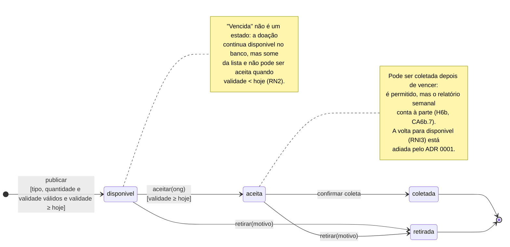

# Diagrama de estados — ciclo de vida de uma doação (versão final)

Versão revisada a partir da [versão original da IA](original-ia.md), com as correções dos
problemas 1 e 2 da [análise crítica](analise-critica.md).

## Como ler

Os quatro estados são os quatro valores possíveis da coluna `status` da tabela `doacoes`.
Cada transição corresponde a uma rota da API:

| Transição | Rota | Condição | Regra |
|---|---|---|---|
| → `disponivel` | `POST /api/doacoes` | os três campos preenchidos, validade numa data real e não anterior a hoje | RN1, RNI1 |
| `disponivel` → `aceita` | `POST /api/doacoes/:id/aceitar` | nome da ONG informado e validade não anterior a hoje | RN3, RN2 |
| `aceita` → `coletada` | `POST /api/doacoes/:id/coletar` | — | ADR 0001 |
| `disponivel` ou `aceita` → `retirada` | `POST /api/doacoes/:id/retirar` | motivo informado | H6c |

## O que o diagrama deixa explícito

- **Não existe transição a partir de `coletada` nem de `retirada`.** São estados finais:
  coletar de novo, retirar o que já foi coletado ou aceitar o que foi retirado são recusados
  com 400.
- **A segunda ONG não aparece aqui.** Duas ONGs aceitando a mesma doação é a mesma
  transição `disponivel → aceita` disputada; quem vence e como está no
  [diagrama de sequência](sequencia.md).

## O que mudou em relação à versão da IA

| Versão da IA | Versão final | Problema |
|---|---|---|
| estado `Vencida` | sai; a expiração vira condição `[validade ≥ hoje]` e uma nota | 1 |
| `Aceita → Disponivel` (RNI3) | sai; nota registra que está adiada | 2 |
| — | estado `retirada`, a partir de `disponivel` e de `aceita` | 2 |
| — | coleta após o vencimento, como nota | 2 |
| nomes com inicial maiúscula | os valores reais da coluna `status` | 1 |
