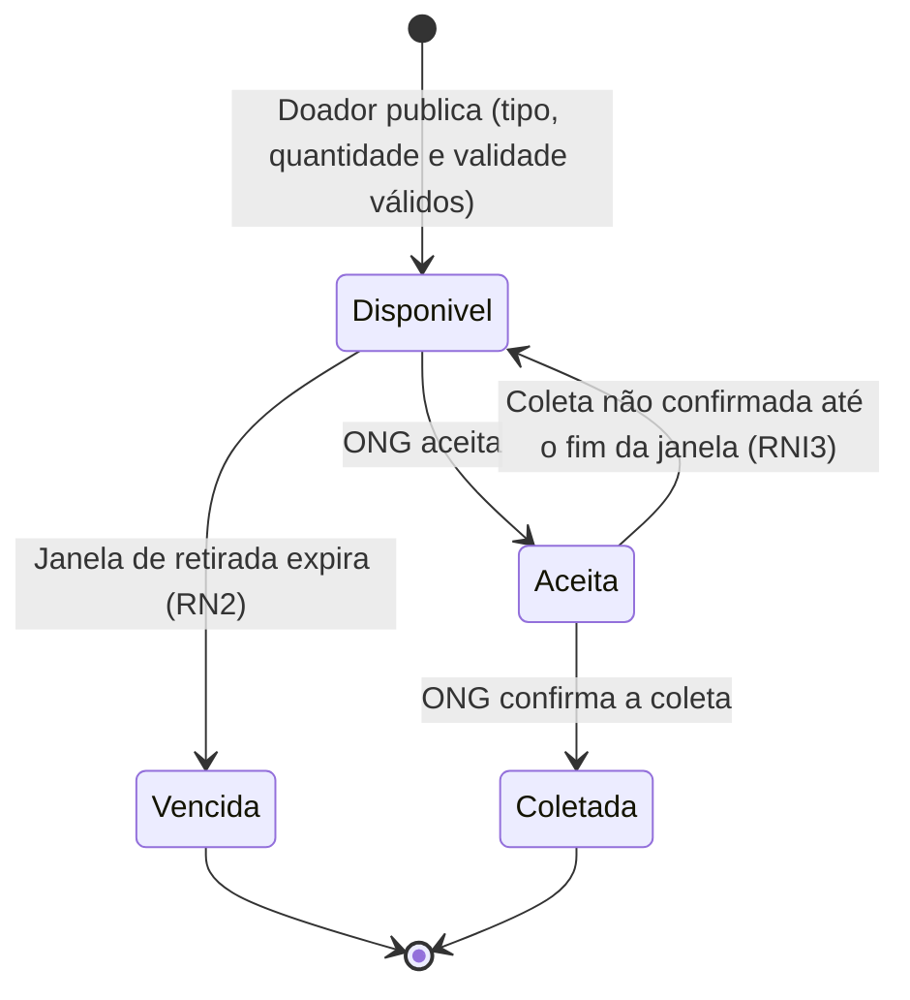
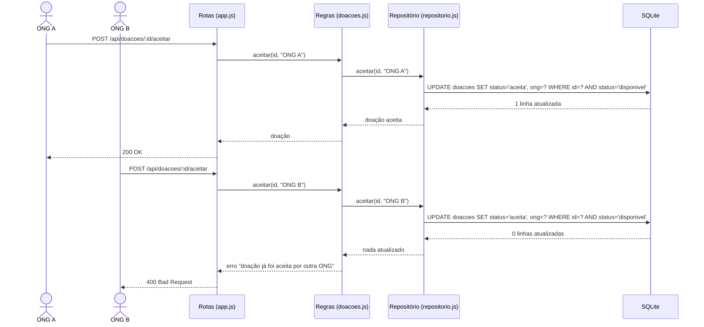

# Versão original gerada pela IA

> **Não editar.** Este arquivo guarda a resposta da IA exatamente como foi produzida, antes
> de qualquer correção do grupo. O prompt está em [`prompt-ia.md`](prompt-ia.md); a análise
> crítica e as versões revisadas ficam em arquivos separados.
>
> Ferramenta: Claude (modelo Claude Opus 5.5), pelo Claude Code · 07/10/2026

---

## 1. Diagrama de estados — ciclo de vida de uma doação

**Explicação.** A doação nasce em *Disponível* quando o doador publica com os três campos
obrigatórios e uma validade futura (RN1, RNI1). A partir daí, uma ONG pode aceitá-la,
levando-a para *Aceita* (RN3), ou a janela de retirada pode expirar, levando-a para
*Vencida* (RN2). De *Aceita*, a ONG confirma a coleta e a doação vai para *Coletada*, o
estado final do ciclo. Se a coleta não for confirmada a tempo, a doação volta para
*Disponível* (RNI3).

## 2. Diagrama de sequência — ONG aceita uma doação

**Explicação.** A ONG A envia o aceite. A requisição passa pelas rotas e pelas regras até
o repositório, que executa um `UPDATE` com a condição `status = 'disponivel'`. Como a
doação ainda está disponível, uma linha é atualizada e a ONG A recebe 200. Quando a ONG B
tenta aceitar a mesma doação, o mesmo `UPDATE` não encontra nenhuma linha disponível, as
regras transformam esse resultado em erro e a ONG B recebe 400. A condição no próprio
`UPDATE` garante a RNI2 mesmo que as duas requisições cheguem ao mesmo tempo (D3).
