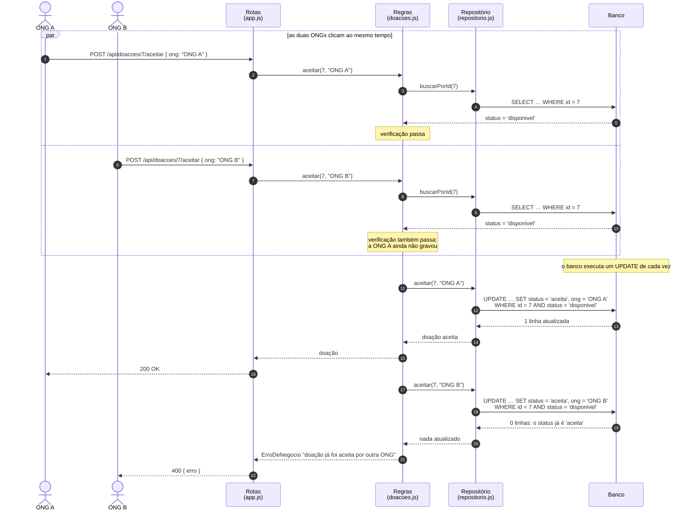
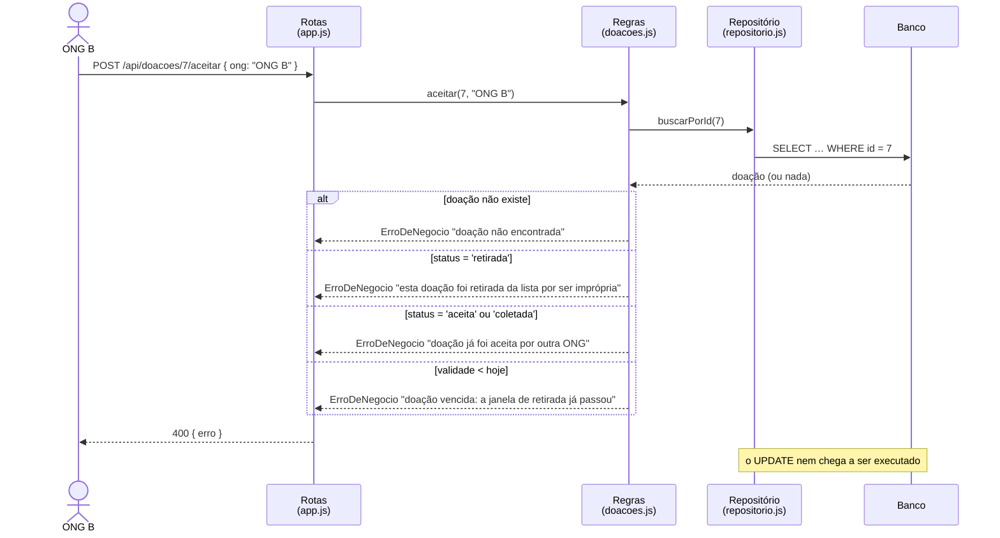

# Diagrama de sequência — duas ONGs aceitam a mesma doação (versão final)

Versão revisada a partir da [versão original da IA](original-ia.md), com as correções dos
problemas 3 e 4 da [análise crítica](analise-critica.md).

## O caso comum: as ONGs não clicam juntas

Quando a ONG B chega depois de a ONG A já ter gravado, a recusa acontece **antes** do
`UPDATE`, na verificação da aplicação:

## O que os dois diagramas mostram juntos (decisão D3)

| Camada | Papel | Quando age |
|---|---|---|
| Verificação em `doacoes.js` | dar a **mensagem certa** para cada motivo de recusa | quase sempre: a ONG B chega depois da ONG A |
| Condição no `UPDATE` | **garantir** que só uma ONG fique com a doação | só quando as duas passam pela verificação ao mesmo tempo |

O banco sozinho garantiria a regra, mas não saberia dizer o motivo da recusa: ele só devolve
"0 linhas". A aplicação sozinha diria o motivo, mas deixaria passar duas ONGs que verificam
ao mesmo tempo. A decisão D3 usa as duas.

Os testes `garantias no próprio UPDATE (decisão D3)`, em `tests/doacoes.test.js`, verificam
o primeiro diagrama: chamam o repositório direto, sem a verificação da aplicação, e conferem
que o segundo `UPDATE` não altera nada.

## O que mudou em relação à versão da IA

| Versão da IA | Versão final | Problema |
|---|---|---|
| Regras → Repositório direto | `buscarPorId` e a verificação antes do `UPDATE` | 3 |
| a recusa da ONG B vem do `UPDATE`, sempre | no caso comum, vem da verificação (segundo diagrama) | 3 |
| sem casos de erro | fragmento `alt` com as quatro recusas e suas mensagens | 3 |
| as ONGs em sequência | fragmento `par`: as duas leem a doação disponível antes de qualquer gravação | 4 |
